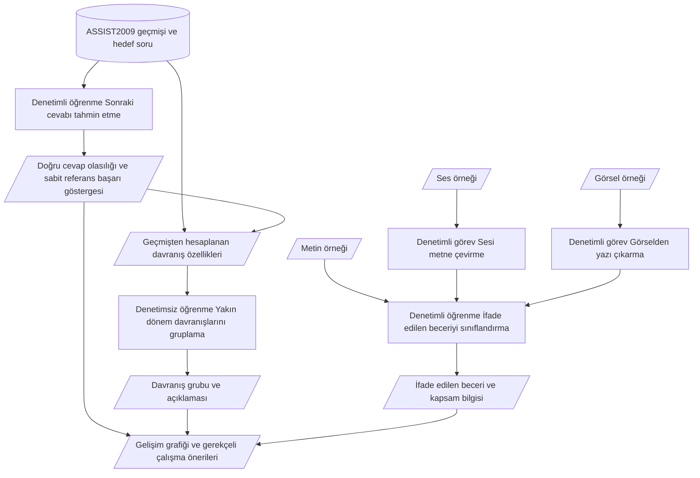

# Öğrenme Blokları ve Veri Akışı

Sistem, öğrenci cevabını tahmin eden denetimli bir bilgi takibi modeli ile yakın dönem davranışlarını gruplandıran denetimsiz bir model içerir. Küçük metin, ses ve görsel örnekleri öğrencinin ifade ettiği beceriyi belirlemeye yönelik giriş işlevlerini gösterir. Bu örnekler bilgi takibi modeline yeni yazılmış soru kimliği eklemez.

## Görev blokları

| Blok | Öğrenme türü | Girdi yapısı | Çıktı yapısı |
|---|---|---|---|
| Sesi metne çevirme | Denetimli görev için önceden eğitilmiş modelin kullanımı | Kısa ses dosyası, örnekleme hızı | Tanınan metin ve örnek kimliği |
| Görselden yazı çıkarma | Denetimli görev için önceden eğitilmiş modelin kullanımı | Kısa yazı içeren örnek görsel | Tanınan metin ve örnek kimliği |
| İfade edilen beceriyi sınıflandırma | Denetimli öğrenme | Metin; eğitimde küçük ve açıkça etiketlenmiş örnek ifadeler | Bilinen beceri etiketi veya kapsam dışı sonucu |
| Sonraki cevabı tahmin etme | Denetimli öğrenme | Geçmiş soru, beceri kümesi, cevap ve eğitimden zorluk; hedef soru ve beceriler. Promptsuz kontrolde hedef zorluğu da kullanılır; KPT ailesinin makale şablonunda kullanılmaz. | Doğru cevap olasılığı |
| Yakın dönem davranışlarını gruplama | Denetimsiz öğrenme | Yakın dönem başarı göstergeleri, cevap süreleri ve mevcutsa ipucu özellikleri | Grup kimliği, grup özellikleri ve örüntü açıklaması |

Ses ve görsel modellerini ASSIST2009 üzerinde yeniden eğitme hedefi yoktur. Hazır modellerin küçük örneklerdeki gerçek çıktıları gösterilir. Metin sınıflandırma örnekleri ise öğrenme etkileşimlerinden elde edilmiş gerçek öğrenci beyanları olarak sunulmaz.

Çalışan küçük örneklerde ASR için sabit sürümlü Whisper base, OCR için Windows Türkçe OCR motoru kullanılır. Beceri sınıflandırıcı karakter TF IDF ve lojistik regresyondur; 48 yazılmış eğitim ifadesiyle öğrenir, kabul eşiği ayrı doğrulama ifadelerinde seçilir. Açık kapsam kuralları ve düşük skorda açıklama isteme davranışı sınıflandırıcıya eşlik eder. İfade edilen beceri, mevcut soru önerisine öncelik sağlar; bu istek cevap geçmişine veya doğru yanlış etiketlerine eklenmez. Tanıma hataları ve küçük derlemin sınırları [ilgili yöntemde](metin_ses_gorsel_ornekleri.md) açıklanır.

## Diyagram

Öğrenme görevleri kutularla; girdi, çıktı ve aritmetik güncellemeler farklı şekillerle gösterilir. Öneri seçme kuralları ve grafik hesapları ayrı öğrenme modeli değildir.

Ana işlev diyagramındaki öğrenme kutuları yalnızca denetimli veya denetimsiz görevdir. Ön eğitimli LKM ağırlıkları girdi olarak gösterilir; özdenetimli RTM/FBO aşaması ayrı eğitim açıklamasındadır. Canlı kayıt, bir öğrenme kutusu değil cevap olaylarını ve zamanlarını saklayan veri katmanıdır. Aynı sabit model yeni oturumun o ana kadarki cevaplarıyla tahmin üretir.

## Bilgi takibi modelinin eğitim akışı

LKM önce RTM ve FBO hedefleriyle yalnızca eğitim öğrencilerinin etkileşimleri üzerinde özdenetimli öğrenir. Bu aşamanın hedefleri verinin kendisinden üretilir. Görev türü, elle verilmiş etiketleri kullanan sonraki cevap tahminiyle karıştırılmaz.

Her başlangıç için aynı LKM kontrol noktası üç yöntemin başlangıcı olur. Promptsuz yöntem geleneksel uyarlamayı, KPT bilgi kavramıyla yönlendirilen promptu, KMPT ise yardımcı soru tahminiyle birlikte çoklu prompt eğitimini kullanır. Hangi bileşenlerin eğitildiği ve parametre sayıları her yöntem için ayrıca kaydedilir.

## Örnek oturum akışı

1. Bağımsız değerlendirmeden ayrılmış bir öğrenci geçmişi seçilir ve geçmişin başlangıç bölümüyle öğrenci durumu oluşturulur.
2. Sıradaki kayıt için cevap görülmeden olasılık hesaplanır.
3. Kayıttaki cevap sisteme eklenir ve güncel geçmiş üzerinden sabit referans göstergeleri hesaplanır.
4. Yakın dönem özellikleri ve davranış grubu güncellenir.
5. Mevcut soru kimlikleri arasından çalışma önerisi üretilir ve gerekçesi gösterilir.
6. Sonraki kayıt geldiğinde aynı akış tekrarlanır. Yeniden oynatım önerilen soruyu gerçekten uygulayan bir deney değildir; kayıttaki sonraki soru farklı olabilir.

Gösterim saati ile kaynakta bulunmayan geçmiş olay zamanı ayrı tutulur. Bir davranış grubunun değişmesi veya önerinin üretilmesi öğrenme kazanımına ilişkin nedensel kanıt olarak sunulmaz.

Yeni canlı oturumda ise boş geçmişten başlanır. Soruyu başlatma, cevapsız hedef için tahmin ve zaman kaydı üretir. Değerlendirilmiş sonuç geldiğinde gerçek alım saati, süre ve ipucu sayısı saklanır; yalnızca bu tamamlanmış olay geçmişe alınır. Her cevap sonrasında aynı tahmin, gruplama ve öneri akışı yeniden çalışır. Gerçek zaman grafiği olaylar arasında son tahmini tutar. Kullanım ve alan şeması [canlı oturum belgesindedir](gercek_zamanli_oturum.md).
